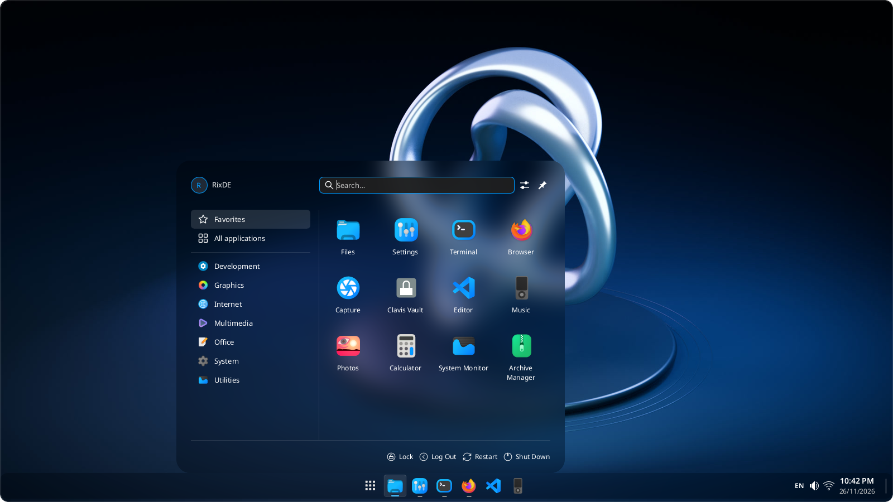
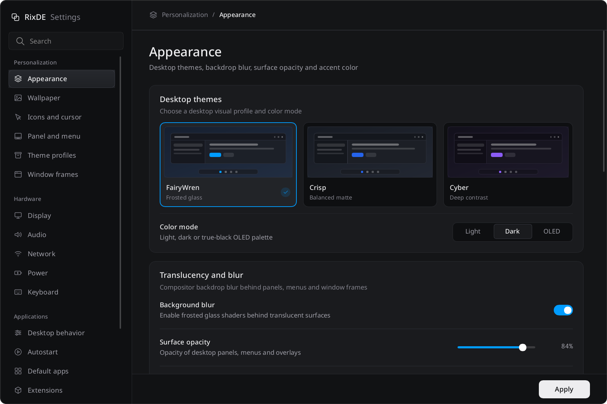
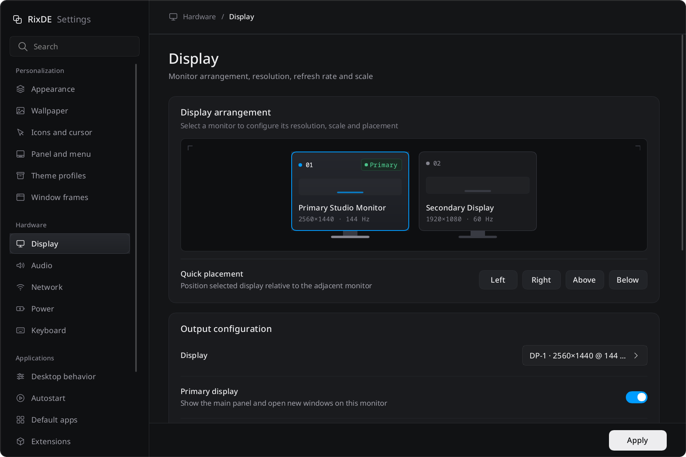
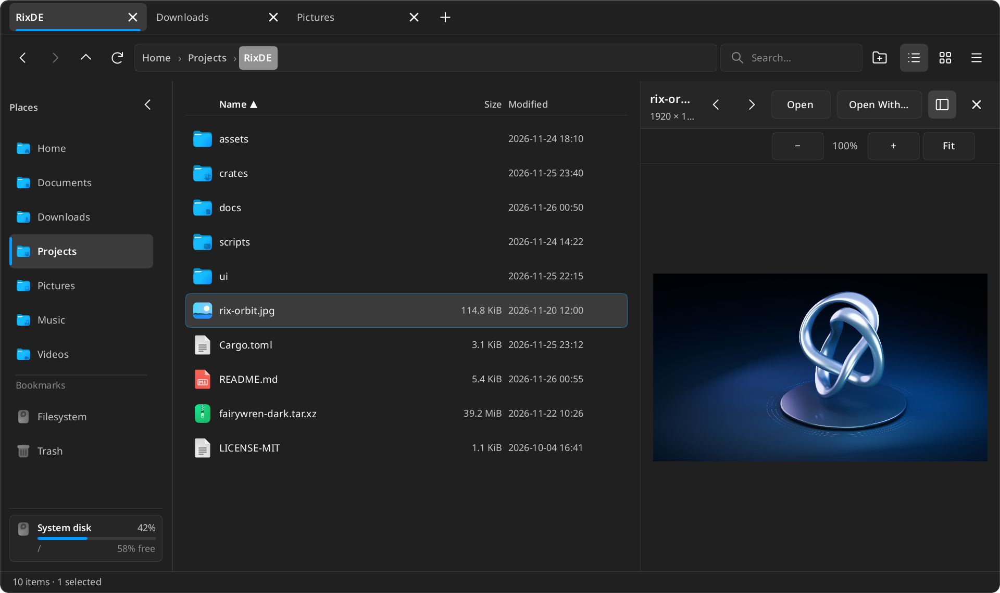
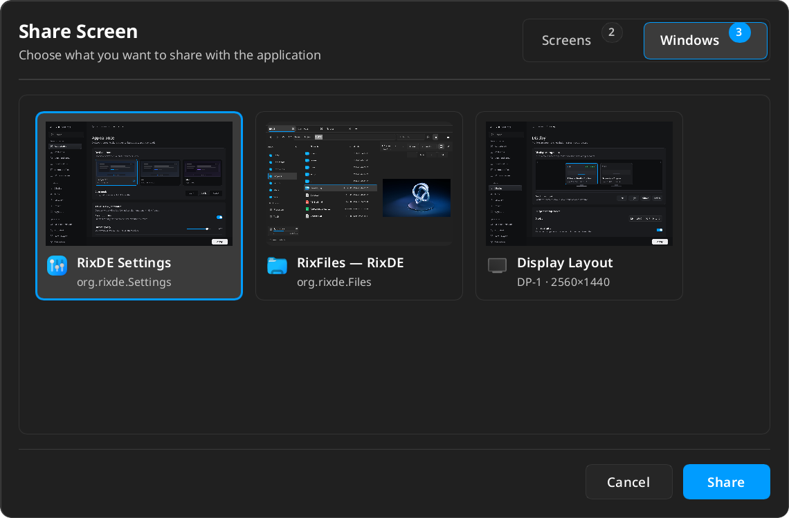
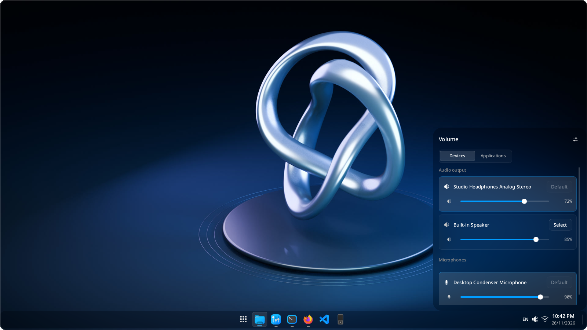

<div align="center">


# RixDE

**A modern, hardware-accelerated Wayland desktop environment written in Rust.**

[](https://www.rust-lang.org/)
[](https://github.com/Smithay/smithay)
[](https://slint.dev/)
[](LICENSE-MIT)

[Showcase](#showcase) · [Highlights](#highlights) · [Architecture](#architecture) · [Build & Install](#building-and-installation) · [Credits](#acknowledgments--credits)

<br />



<sub>RixDE Desktop running the bundled FairyWren Dark theme — floating glass panel, application launcher, and Dual-Kawase backdrop blur.</sub>

</div>

---

## Showcase

<table>
  <tr>
    <td width="50%" align="center">
      
      <br />
      <sub><strong>Unified Control Center</strong> — live theme previews, Light / Dark / OLED modes, and frosted glass blur shaders</sub>
    </td>
    <td width="50%" align="center">
      
      <br />
      <sub><strong>Multi-Monitor Display Manager</strong> — interactive arrangement stage, primary display, fractional scaling, and mirroring</sub>
    </td>
  </tr>
  <tr>
    <td width="50%" align="center">
      
      <br />
      <sub><strong>RixFiles</strong> — tabbed browsing, virtual scrolling, archive handling, and inline split preview</sub>
    </td>
    <td width="50%" align="center">
      
      <br />
      <sub><strong>Native Screen Sharing</strong> — live monitor and window thumbnails powered by <code>xdg-desktop-portal-wlr</code></sub>
    </td>
  </tr>
</table>

<div align="center">
  
  <br />
  <sub><strong>Panel Quick Popups</strong> — frosted glass PipeWire/PulseAudio mixer, network manager, calendar, clipboard history, and keyboard switcher</sub>
</div>

---

## Highlights

- **Hardware-Accelerated Wayland Compositor (`rix-comp`)** — Built on Smithay with native DRM/KMS and nested backends, Dual-Kawase & Gaussian backdrop blur with subtle film grain, rounded window clipping, server-side decorations, fractional scaling, multi-monitor layouts, and capture-card mirroring.
- **Cohesive Desktop Shell (`rix-shell`)** — Floating or docked panels, interactive panel editor, drag-to-reorder taskbar with live window previews and per-app audio controls, application launcher, StatusNotifierItem tray, clipboard history, and system status popups.
- **Redesigned Control Center (`rix-settings`)** — Unified Slint interface covering themes (Light / Dark / OLED), blur shaders, wallpaper & video backgrounds, display arrangement, audio devices, NetworkManager profiles, power plans, autostart, plugins, and portable theme archive backup/import.
- **Fast Native File Manager (`rix-files`)** — Multi-tab navigation, breadcrumbs, virtualized scrolling, inline split preview for images, PDFs, and text, native archive browsing & extraction (`ZIP`, `TAR`, `7z`, `RAR`), and XDG FileChooser portal integration.
- **Screen Capture & Casting (`rix-capture` & `rix-screen-picker`)** — Interactive screenshot utility with markup annotations and magnifier, paired with a native Wayland screen/window picker with live previews and remote-control consent.
- **Built-In Login Stack & Vault (`rix-dm` / `clavis`)** — Linux PAM-backed display manager, greeter, and screen locker alongside Clavis encrypted Secret Service credential storage.

---

## Architecture

| Component | Role |
| :--- | :--- |
| **`rix-comp`** | Smithay-based Wayland compositor with DRM/KMS & nested backends, shaders, SSDs, and multi-monitor control |
| **`rix-shell`** | Desktop panels, application launcher, taskbar, window switcher, tray, and quick status popups |
| **`rix-settings`** | Control center for appearance, displays, audio, networking, power, input, plugins, and theme profiles |
| **`rix-files`** | Native file manager with virtual scrolling, split previews, archive extraction, and XDG file portal |
| **`rix-capture`** | Screenshot tool with region selection, magnifier, markup editor, and instant clipboard copy |
| **`rix-screen-picker`** | Native Slint monitor/window chooser for Wayland ScreenCast (`rix-portal-wlr`) |
| **`rix-dm` · `rix-greeter` · `rix-lock`** | Display manager, login greeter, and session locker integrated with Linux PAM |
| **`rix-portal` · `rix-ctl` · `rix-rar`** | XDG desktop portal backend, CLI IPC controller, and isolated RAR extraction helper |
| **`clavis`** | Secret Service daemon, encrypted credential vault, and prompt UI |

---

## Building and Installation

### Prerequisites

Ensure you have **Rust (stable, 2021 edition)** and the required system libraries installed:

- **Graphics & Wayland:** `wayland`, `wayland-protocols`, `mesa`, `gbm`, `egl`, `drm`, `xkbcommon`
- **Audio & Media:** `pipewire`, `pipewire-pulse` (or `libpulse`), `xdg-desktop-portal-wlr` *(for screen sharing)*
- **System & Fonts:** `pam`, `systemd` / `logind`, `fontconfig`, `freetype`, `zenity` *(for remote-control consent)*

### Build

Compile all release binaries (workspace + `rix-rar`):

```bash
./scripts/rix-build-release
```

### Install

Install binaries, desktop session entry, PAM policies, systemd services, and the default FairyWren Dark theme:

```bash
sudo ./scripts/rix-install
```

To stage an installation into a separate directory without modifying the host system:

```bash
./scripts/rix-install --destdir /tmp/rix-stage --prefix /usr
```

To try the compositor nested inside an existing Wayland or X11 session:

```bash
./target/release/rix-comp --nested
```

---

## License

RixDE is licensed under the **[MIT License](LICENSE-MIT)**.

Bundled third-party theme assets and fonts are distributed under their respective open-source licenses (`GPL-3.0`, `LGPL-3.0`, and `SIL Open Font License 1.1`). Full license texts are included in `assets/rix/themes/fairywren-dark/licenses/`.

---

## Acknowledgments & Credits

Deepest gratitude to the open-source projects and communities that made RixDE possible:

- **[KDE Community](https://kde.org/)** — Special thanks to the KDE project. The visual design, ergonomics, and aesthetic elegance of RixDE were heavily inspired by KDE Plasma.
- **FairyWren** — Thanks to the creators of the **FairyWren** theme and icon project for their artwork and visual direction.
- **[Smithay](https://github.com/Smithay/smithay)** — Appreciation to the Smithay maintainers and contributors for the Rust Wayland compositor framework powering `rix-comp`.
- **[Slint](https://slint.dev/)** — Thanks to the Slint team for the expressive declarative GUI toolkit behind RixDE's shell, control center, file manager, and dialogs.
